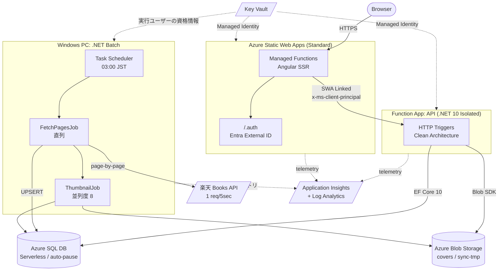
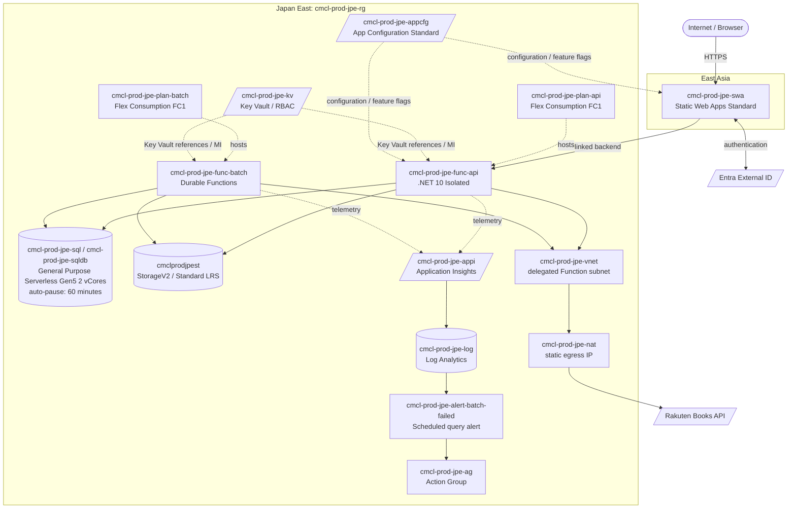

# 06. アーキテクチャ概要

> **2026-11 改訂（[ADR 0004](../../adr/0004-azure-cost-reduction.md)）**: 日次収集を Windows コンソールアプリに移行しました。
>
> - Batch は Azure にデプロイせずメンテナー PC で実行。API は楽天 API を呼ばない（検索は DB のみ）。VNet / NAT Gateway / App Configuration は廃止。

## 6.1 技術スタック（latest = 2026 年 4 月時点）

| 区分 | 採用技術 | 備考 |
|---|---|---|
| Frontend | **Angular v21** + Tailwind CSS **v4** + tailwindcss-typography + Angular CDK | Standalone Components / Signals / Zoneless / SSR (Hybrid) |
| Frontend Hosting | **Azure Static Web Apps Standard** | Managed Functions で SSR 実行 |
| Backend API | **Azure Functions (.NET 10 Isolated Worker)** | SWA-linked Functions |
| Backend Batch | **.NET 10 Generic Host コンソールアプリ** | メンテナーの Windows PC で毎日 03:00 JST |
| Database | **Azure SQL Database Serverless** (General Purpose, auto-pause) | Database First (SSDT/DACPAC が SoT) |
| ORM | **EF Core 10** | DACPAC からの scaffold |
| Storage | **Azure Blob Storage** | 表紙画像、CDN なし直接配信 |
| Identity | **Entra External ID** (旧 AD B2C) | Microsoft / Google / X(Twitter) |
| Secrets | **Key Vault** + **Managed Identity** | App Settings に KV 参照リンク |
| IaC | **Bicep** | modules: data / app / observability / batch-operator / budget |
| 監視 | **Application Insights + Log Analytics** | + Alert Rules |
| 開発環境 | **DevContainer** | `devcontainers/dotnet` ベース |
| テスト | **Jest** (FE) / **xUnit** (BE) / **Playwright + Testcontainers** (E2E) | カバレッジ ≥ 80% |
| パッケージ管理 | **pnpm workspace**（FE / E2E）+ **dotnet (sln)**（BE）|  |

> Angular v21 はデフォルトテストランナーが Vitest に変更されているが、本プロジェクトは **Jest を継続採用**。

## 6.2 論理構成図

### 6.2.1 移行前の Azure 物理構成（2026-09-21 時点）

> API とバッチは同じ `Microsoft.App/environments` 委任サブネットへ VNet 統合し、NAT Gateway の静的 Public IP を楽天 API の IP allowlist に登録していました。バッチ収集と API 検索フォールバックの送信元 IP を共通化していた構成です。

## 6.3 データフロー

1. **収集フロー（バッチ）**: Windows タスク スケジューラ (03:00 JST) → FetchPagesJob が楽天 Books API を 1req/5sec でページング → Series/Volumes を UPSERT → ThumbnailJob が画像を取得し、新規 / 変更分を Blob に保存（CoverHash で同一性判定）。
2. **閲覧フロー**: Browser → SWA SSR → SWA-linked Functions API → SQL/Blob。SSR で Transfer State にデータを埋め込み、ハイドレーション時の再取得を抑制。
3. **書き込みフロー**: ユーザー操作 → SSR を介して Functions に POST/PUT/DELETE。匿名はローカル IndexedDB に書き込みのみ。

## 6.4 環境

Azure は prod（`cmcl-prod-jpe-*`）を運用する。開発・確認は DevContainer 内で行う。本番の設定は [prod.bicepparam](../../../infra/params/prod.bicepparam) で管理する。

## 6.5 トポロジ原則

- API は Azure Functions、Batch はメンテナーの Windows PC で実行する。
- API は SWA-linked（SWA からのトラフィックのみ受信）。`Authorization=function` + SWA Auth ヘッダで二重防御。
- Batch の手動起動は配置済みの `ComiCal.Batch.exe run` を使う。
- DB / Storage はAPI と Batch で共有する。

## 6.6 可用性 / SLA

- **SLA 目標は無指定（ベストエフォート）**。コスト最小優先。
- DR / マルチリージョン構成は持たない。Azure SQL の自動バックアップ（標準）に依存。

## 6.7 拡張性

- 将来の負荷増加に備え、SQL は **Serverless → Provisioned** へのスケールパスを残す（Bicep param `sql.tier` で切替可能に設計）。
- Blob は CDN 前段化を将来検討（Azure Front Door）。
